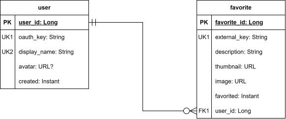



## Page contents
{:.no_toc}

{:.collapsible}
- ToC
{:toc}

## Entity-relationship diagram (ERD)

## Data-definition language (DDL) for app database

[//]: # (TODO Use include to display clickable SQL file.)
